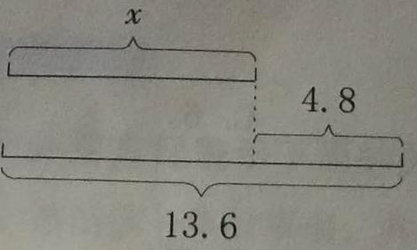

# Mathematics (Grade 3)

**ID**: a6fe41ed
**难度**: medium
**题型**: short_answer

## 题目

 x    13.6    4.8

## 解答

**答案**: 8.8

1. Step1:根据图中数量关系列出方程x + 4.8 = 13.6
2. Step2:为求解x，将方程变形为x = 13.6 - 4.8
3. Step3:计算13.6 - 4.8的结果为8.8，得出x = 8.8

## 知识点

**知识点**:
  - --

---
