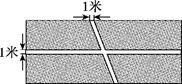

# Mathematics (Grade 3)

**ID**: ad0715d6
**难度**: medium
**题型**: short_answer

## 题目
如图是一块长方形菜地，长是50米，宽是20米，菜地中间有两条石子路。种菜部分(阴影部分)的面积有多大？

## 解答

**答案**: 931

1. Step1:根据解析2可知，把四块阴影部分拼在一起可得到新长方形，新长方形的长由原来长方形菜地的长50米减去石子路的宽1米得到，即50 - 1 = 49米
2. Step2:新长方形的宽由原来长方形菜地的宽20米减去石子路的宽1米得到，即20 - 1 = 19米
3. Step3:根据长方形面积公式，面积等于长乘宽，所以种菜部分（阴影部分）面积为49×19 = 931平方米

## 知识点

**知识点**:
  - 小学数学;数与代数;应用题;复合应用题

---
