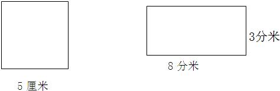

# Mathematics (Grade 3)

**ID**: ae35ebde
**难度**: medium
**题型**: short_answer

## 题目
计算下面正方形和长方形的周长．             

## 解答

**答案**: 20厘米, 22厘米

1. Step1:明确正方形周长公式为边长×4，长方形周长公式为（长+宽）×2
2. Step2:对于正方形，已知边长为5厘米，根据公式计算其周长为4×5 = 20厘米
3. Step3:对于长方形，已知长为8分米，宽为3分米，先计算长加宽为8 + 3 = 11分米，再根据公式计算其周长为11×2 = 22分米

## 知识点

**知识点**:
  - 长方形的周长；正方形的周长．

---
