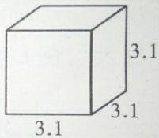

# Mathematics (Grade 3)

**ID**: ae798c07
**难度**: medium
**题型**: short_answer

## 题目
用玻璃制作一个如下图的鱼缸（无盖），至少要玻璃多少平方分米？（单位：dm）

 3.1  3.1  3.1

## 解答

**答案**: 48.05(dm²)

1. Step1:确定鱼缸形状为正方体，其棱长为3.1dm
2. Step2:因为鱼缸无盖，所以需要计算5个面的面积
3. Step3:根据正方形面积公式S = a²，其中a = 3.1dm，先算出一个面的面积为3.1×3.1 = 9.61dm²
4. Step4:再计算5个面的总面积为9.61×5 = 48.05dm²

## 知识点

**知识点**:
  - 

---
