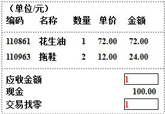

# Mathematics (Grade 3)

**ID**: bd27602d
**难度**: medium
**题型**: short_answer

## 题目
妈妈到超市购物，小票如下．列式算一算，妈妈付款后实际找回多少元？

## 解答

**答案**: 4

1. Step1:从购物小票可知，花生油的金额是72元
2. Step2:从购物小票可知，拖鞋的金额是24元
3. Step3:已知妈妈付的现金是100元
4. Step4:根据减法的意义，用妈妈付的现金100元减去花生油的金额72元，即100 - 72 = 28元
5. Step5:再用上述结果28元减去拖鞋的金额24元，即28 - 24 = 4元，此为应找回的钱数

## 知识点

**知识点**:
  - 整数、小数复合应用题．

---
