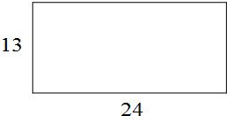

# Mathematics (Grade 3)

**ID**: c069e382
**难度**: medium
**题型**: short_answer

## 题目
计算下面图形的周长．(单位：厘米) 

## 解答

**答案**: 74

1. Step1:明确图形为长方形，长是24厘米，宽是13厘米
2. Step2:根据长方形周长公式，长方形的周长=(长+宽)×2，这里长为24厘米，宽为13厘米，所以先计算长加宽，即24 + 13 = 37厘米
3. Step3:再将长加宽的和乘以2，即37×2 = 74厘米，得到长方形的周长

## 知识点

**知识点**:
  - 长方形的周长．

---
