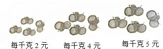

# Mathematics (Grade 3)

**ID**: c0ff995d
**难度**: medium
**题型**: short_answer

## 题目
用20元钱可以买如图所示的桃子各多少千克？（注：20元要正好用完）

## 解答

**答案**: 10, 5, 4

1. Step1:明确问题是求20元按不同单价可购买桃子的重量
2. Step2:根据解析2，知道用总钱数除以单价可得到购买重量
3. Step3:计算每千克2元的桃子可购买重量，20÷2=10（千克）
4. Step4:计算每千克4元的桃子可购买重量，20÷4=5（千克）
5. Step5:计算每千克5元的桃子可购买重量，20÷5=4（千克）

## 知识点

**知识点**:
  - 图文应用题．

---
