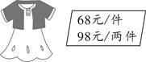

# Mathematics (Grade 3)

**ID**: c7fa9fe0
**难度**: medium
**题型**: short_answer

## 题目
4000元最多能够批发多少件这样的衣服？还剩多少元？

## 解答

**答案**: 81, 12

1. Step1:计算4000元按98元两件的方式能买几次，4000÷98=40(次)……80(元)
2. Step2:计算剩下的80元按68元一件能买几件，80÷68=1(件)……12(元)
3. Step3:计算总共能买的件数，40×2+1=81(件)

## 知识点

**知识点**:
  - 小学数学;数与代数;应用题;简单应用题;整数简单应用题

---
