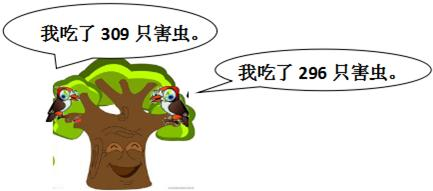

# Mathematics (Grade 3)

**ID**: c833f757
**难度**: medium
**题型**: short_answer

## 题目

他们一共吃了多少只害虫？

## 解答

**答案**: 605

1. Step1:明确题目是求两只小鸟吃害虫数量的总和
2. Step2:根据解析2，确定通过加法运算求解，列出算式309 + 296
3. Step3:计算309 + 296的结果为605

## 知识点

**知识点**:
  - 整数的加法和减法

---
