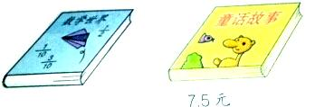

# Mathematics (Grade 3)

**ID**: c8f9f2e0
**难度**: medium
**题型**: short_answer

## 题目
小兰买了一本《数学世界》和一本《童话故事》，一共花了17.3元．《数学世界》的定价是多少元？

## 解答

**答案**: 9.8

1. Step1:明确已知条件为买一本《数学世界》和一本《童话故事》总共花了17.3元，《童话故事》定价7.5元
2. Step2:根据用花的总钱数减去《童话故事》的钱数就是《数学世界》的定价这一思路
3. Step3:进行计算17.3 - 7.5 = 9.8元，得到《数学世界》的定价

## 知识点

**知识点**:
  - 小数的加法和减法

---
