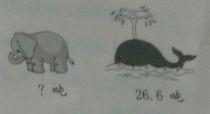

# Mathematics (Grade 3)

**ID**: d1c30235
**难度**: medium
**题型**: short_answer

## 题目
世界上体重最重的两种动物是鲸和象，如图，已知鲸的体重约是象的9.5倍，象的体重大约是多少吨？

 ？吨   26.6吨

## 解答

**答案**: 2.8

1. Step1:明确已知条件，鲸的体重是26.6吨，且鲸的体重约是象的9.5倍
2. Step2:根据倍数关系，求象的体重需用鲸的体重除以倍数，即列出算式26.6÷9.5
3. Step3:计算26.6÷9.5的结果为2.8吨，得到象的体重大约是2.8吨

## 知识点

**知识点**:
  - --

---
