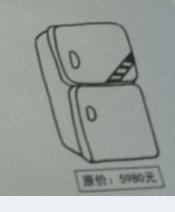

# Mathematics (Grade 3)

**ID**: d498eafa
**难度**: medium
**题型**: short_answer

## 题目
同乐超市在春节时搞促销活动．家用电器八五折酬宾．李叔叔现在购买这5台电冰箱需付多少钱？

 原价：5980元

## 解答

**答案**: 23920

1. Step1:明确电冰箱的原价为5980元
2. Step2:根据促销活动，计算出一台电冰箱的折后价格，即5980×85%
3. Step3:已知要购买5台电冰箱，计算5台电冰箱的折后总价，即5980×85%×5
4. Step4:得出结果23920元

## 知识点

**知识点**:
  - 

---
