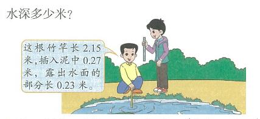

# Mathematics (Grade 3)

**ID**: da77de74
**难度**: medium
**题型**: short_answer

## 题目

 水深多少米？
 这根竹竿长2.15米，插入泥中0.27米，露出睡眠的部分长0.23米.

## 解答

**答案**: 1.65

1. Step1:明确竹竿长度为2.15米，插入泥中的长度是0.27米，露出水面的长度是0.23米
2. Step2:因为要求水深，而水深等于竹竿总长度减去插入泥中的长度再减去露出水面的长度，所以列式为2.15 - 0.27 - 0.23
3. Step3:先计算0.27 + 0.23 = 0.5
4. Step4:再计算2.15 - 0.5 = 1.65米，此即为水深

## 知识点

**知识点**:
  - 小数加、减法;练习六

---
