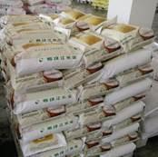

# Mathematics (Grade 3)

**ID**: dd7c3f35
**难度**: medium
**题型**: short_answer

## 题目
粮店运来一批大米，上午卖出6.85吨，下午卖出4.65吨。正好卖完，这批大米多少吨？

## 解答

**答案**: 11.5

1. Step1:明确已知条件，上午卖出大米6.85吨，下午卖出大米4.65吨
2. Step2:根据大米的总吨数=上午卖出的吨数+下午卖出的吨数这一关系，列出算式6.85 + 4.65
3. Step3:计算6.85 + 4.65的结果为11.5吨，即这批大米的吨数

## 知识点

**知识点**:
  - 小学数学;数与代数;应用题;简单应用题;小数加法、减法应用题

---
