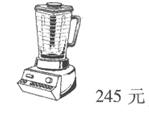

# Mathematics (Grade 3)

**ID**: df8067e6
**难度**: medium
**题型**: short_answer

## 题目
刘师傅有1000元钱，最多可以买几个这样的榨汁机？     

## 解答

**答案**: 4

1. Step1:明确问题是求1000元里最多有几个245元，即求1000除以245的商
2. Step2:计算1000÷245，得到商为4，余数为20
3. Step3:因为余下的20元不够再买一个榨汁机，所以最多能买的榨汁机数量就是商的值4

## 知识点

**知识点**:
  - 有余数的除法应用题．

---
