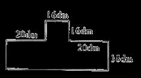

# Mathematics (Grade 3)

**ID**: e498b19e
**难度**: medium
**题型**: short_answer

## 题目
计算下面图形的面积。

## 解答

**答案**: 1264平方分米

1. Step1:将图形分割为一个边长为16分米的正方形和一个长为(20+16+20)分米、宽为18分米的长方形
2. Step2:根据正方形面积公式S=a²，计算正方形面积，其中a=16分米，可得16×16=256平方分米
3. Step3:计算长方形的长为20+16+20=56分米
4. Step4:根据长方形面积公式S=ab，其中a=56分米，b=18分米，可得56×18=1008平方分米
5. Step5:将正方形面积与长方形面积相加，即256+1008=1264平方分米，得到图形总面积

## 知识点

**知识点**:
  - 

---
