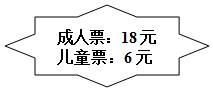

# Mathematics (Grade 3)

**ID**: eaf727ca
**难度**: medium
**题型**: short_answer

## 题目
小云买了4张成人票和2张儿童票，一共用去多少元？

## 解答

**答案**: 84

1. Step1:明确成人票单价为18元，小云买了4张成人票，根据总价=单价×数量，可算出买成人票花费18×4元
2. Step2:明确儿童票单价为6元，小云买了2张儿童票，根据总价=单价×数量，可算出买儿童票花费6×2元
3. Step3:将买成人票的花费与买儿童票的花费相加，即18×4 + 6×2元
4. Step4:先计算18×4 = 72，再计算6×2 = 12
5. Step5:计算72 + 12 = 84，得到一共用去84元

## 知识点

**知识点**:
  - 整数的乘法及应用;整数的加法和减法

---
