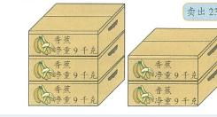

# Mathematics (Grade 3)

**ID**: eb29e1a9
**难度**: medium
**题型**: short_answer

## 题目
还剩下多少千克？

 香蕉净重9千克 香蕉净重9千克 香蕉净重9千克 香蕉净重9千克 香蕉净重9千克
 卖出23.7千克

## 解答

**答案**: 21.3

1. Step1:先计算香蕉的总重量，因为有5箱香蕉，每箱净重9千克，所以总重量为5×9 = 45千克
2. Step2:已知卖出23.7千克，用总重量减去卖出的重量，即45 - 23.7 = 21.3千克，得到剩余重量

## 知识点

**知识点**:
  - 小数加、减法;练习六

---
