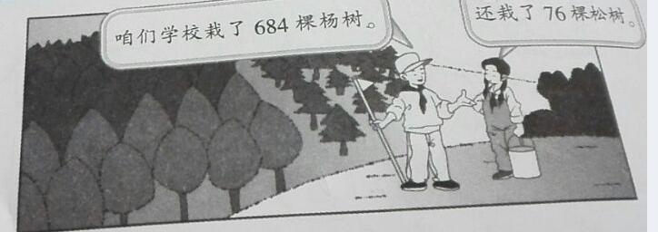

# Mathematics (Grade 3)

**ID**: efd479be
**难度**: medium
**题型**: short_answer

## 题目
杨树棵树是松树的多少倍？

 咱们学校栽了684棵杨树.
 还栽了76棵松树.

## 解答

**答案**: 9

1. Step1:明确问题是求杨树棵树是松树的多少倍，已知杨树有684棵，松树有76棵
2. Step2:根据倍数关系，用杨树的棵树除以松树的棵树，即列出算式684÷76
3. Step3:计算684÷76的结果，得到9

## 知识点

**知识点**:
  - --

---
