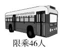

# Mathematics (Grade 3)

**ID**: f505ea9f
**难度**: medium
**题型**: short_answer

## 题目
一辆大客车准乘46人，2辆这样的大客车可以坐多少人？

## 解答

**答案**: 92

1. Step1:明确问题是求2辆准乘46人的大客车可坐人数，即求2个46的和
2. Step2:根据乘法的意义，将问题转化为算式46×2
3. Step3:按照两位数乘一位数的法则计算46×2的结果为92

## 知识点

**知识点**:
  - 一位数乘两、三位数

---
