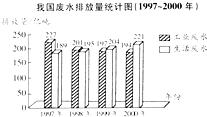

# Mathematics (Grade 4)

**ID**: 42685649
**难度**: hard
**题型**: fill_in_the_blank

## 题目
下图是我国1997～2000年废水排放量统计图
（1）1997～2000年我国工业废水排放量呈现逐年$\underline{\hspace{5em}}$的趋势．
（2）1997～2000年我国生活废水排放量呈现逐年$\underline{\hspace{5em}}$的趋势
（3）看完这张统计图，你有什么感想？

## 解答

**答案**: 减少, 增加, 应减少污水的排放，加强环保

1. Step1:观察统计图，确定深颜色代表工业废水排放量，浅颜色代表生活废水排放量
2. Step2:查看1997 - 2000年工业废水排放量对应的条形高度变化，得出其逐年减少
3. Step3:查看1997 - 2000年生活废水排放量对应的条形高度变化，得出其逐年增加
4. Step4:结合环保情况，得出应减少污水排放，加强环保的感想

## 知识点

**知识点**:
  - 两种不同形式的复式条形统计图；从统计图表中获取信息；统计结果的解释和据此作出的判断和预测．

---
