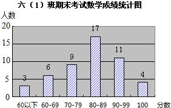

# Mathematics (Grade 4)

**ID**: 4afda4a2
**难度**: hard
**题型**: fill_in_the_blank

## 题目
如图是六（1）班期末考试数学成绩统计图，看图回答下面问题．
（1）该班学生成绩的中位数，应该在(    )-(    )的分数段内；

（2）如果90分及以上为优秀，这次考试的优秀率是(    )%．
（3）根据图中数据，该班学生期末数学考试的平均成绩应该在几分至几分的区间内．

## 解答

**答案**: 80, 89, 30

1. Step1:计算该班总人数，将各分数段人数相加，即3 + 6 + 9 + 17 + 11 + 4 = 50人
2. Step2:确定中位数位置，由于总人数50为偶数，中位数是第25、26个数据的平均数
3. Step3:计算80分以下人数，3 + 6 + 9 = 18人
4. Step4:计算90分及以上人数，11 + 4 = 15人
5. Step5:判断第25、26个数据不在80分以下和90分及以上，所以中位数在80 - 89分数段
6. Step6:计算优秀人数，11 + 4 = 15人
7. Step7:计算优秀率，15÷50×100% = 30%
8. Step8:根据各分数段人数分布，80 - 89分人数最多，80分以下和89分以上人数差不多，判断平均成绩在80 - 89分区间

## 知识点

**知识点**:
  - 以一当五（或以上）的条形统计图；从统计图表中获取信息．

---
