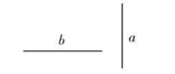

# Mathematics (Grade 4)

**ID**: 638b3957
**难度**: hard
**题型**: fill_in_the_blank

## 题目
看看下面的说法对吗？对的在括号里打“√”，错的打“×”。

（1）直线a与直线b不相交。（）
（2）直线a与直线b会相交。（）
（3）直线a与直线b互相垂直。（）
（4）直线b是垂线。（）
（5）直线a与直线b不相交，所以两者不存在垂直关系。（）

## 解答

**答案**: ×, √, √, ×, ×

1. Step1:根据直线可无限延长的性质，将直线b向右延长，发现直线a与直线b会相交，所以（1）直线a与直线b不相交说法错误，答案为×
2. Step2:因为延长直线b后与直线a相交，所以（2）直线a与直线b会相交说法正确，答案为√
3. Step3:用量角器测量直线b延长后与直线a相交处角的大小，发现相交而成的四个角都是直角，根据垂线定义可知直线a与直线b互相垂直，所以（3）直线a与直线b互相垂直说法正确，答案为√
4. Step4:由于垂线是两条直线之间的关系，不能单独说一条直线是垂线，所以（4）直线b是垂线说法错误，答案为×
5. Step5:直线a与直线b虽原本看似不相交，但延长后相交且夹角为直角，存在垂直关系，所以（5）直线a与直线b不相交所以两者不存在垂直关系说法错误，答案为×

## 知识点

**知识点**:
  - 相交与垂直

---
