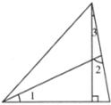

# Mathematics (Grade 4)

**ID**: 80aafcec
**难度**: hard
**题型**: fill_in_the_blank

## 题目
如图∠1=25°，∠2=80°，∠3=$\underline{\hspace{5em}}$．

## 解答

**答案**: 15°

1. Step1:根据三角形内角和为180°，可知∠1+∠2+∠4=180°
2. Step2:已知∠1=25°，∠2=80°，计算∠4的度数，∠4=180°-∠1-∠2=180°-25°-80°=75°
3. Step3:因为∠5是直角，即90°，所以∠3+∠4=90°
4. Step4:计算∠3的度数，∠3=90°-∠4=90°-75°=15°

## 知识点

**知识点**:
  - 角的度量．

---
