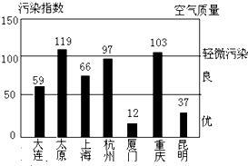

# Mathematics (Grade 4)

**ID**: 92790169
**难度**: hard
**题型**: fill_in_the_blank

## 题目
如图是2007年6月13日全国部分城市空气质量情况统计图．看图以后回答问题：
（1）这是一幅$\underline{\hspace{5em}}$统计图．从图中可知，当污染指数达到$\underline{\hspace{5em}}$时，空气质量为“轻度污染”．
（2）从图中你还知道什么？（写出2～3个信息）

## 解答

**答案**: 条形, 100

1. Step1:观察统计图的形状，发现是由长短不同的直条表示数据，得出这是一幅条形统计图
2. Step2:查看统计图中空气质量为“轻微污染”对应的污染指数数值，可知当污染指数达到100时，空气质量为“轻微污染”

## 知识点

**知识点**:
  - 以一当五（或以上）的条形统计图；从统计图表中获取信息．

---
