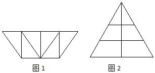

# Mathematics (Grade 4)

**ID**: 95ddb841
**难度**: hard
**题型**: fill_in_the_blank

## 题目

（1）如图1，有$\underline{\hspace{5em}}$      个梯形，有$\underline{\hspace{5em}}$      个平行四边形，有$\underline{\hspace{5em}}$      个三角形．
（2）如图2，有$\underline{\hspace{5em}}$      个梯形，有$\underline{\hspace{5em}}$      个三角形．

## 解答

**答案**: 5, 5, 7, 9, 9

1. Step1:计算图1中梯形的数量，先分析以AB为底有2个，以BC为底有2个，以AC为底有1个，即2 + 2 + 1 = 5个
2. Step2:计算图1中平行四边形的数量，以AB为底有2个，以BC为底有2个，以AC为底有1个，即2 + 2 + 1 = 5个
3. Step3:计算图1中三角形的数量，单个的有6个，三角形3和4又组成1个，即6 + 1 = 7个
4. Step4:计算图2中梯形的数量，单个的有4个，组合的有4个，还有1个大梯形，即4 + 4 + 1 = 9个
5. Step5:计算图2中三角形的数量，以AB为底有3个，以CD为底有3个，以EF为底有3个，即3 + 3 + 3 = 9个

## 知识点

**知识点**:
  - 组合图形的计数

---
