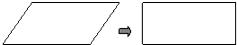

# Mathematics (Grade 4)

**ID**: 1630bf01
**难度**: hard
**题型**: multiple_choice

## 题目
如图，利用割补法把平行四边形转化成长方形时，长方形的周长（  ）

$\begin{description}
\item A．不变\item B．变大\item C．变小\item D．无法确定
\end{description}$

## 解答

**答案**: C

1. Step1:明确将平行四边形沿一条高剪开，会分成一个直角三角形与一个直角梯形
2. Step2:把直角三角形平移到直角梯形不是直角边的一边，拼成一个长方形
3. Step3:确定拼成的长方形的长是平行四边形的底，拼成的长方形的宽是平行四边形的高
4. Step4:依据在直角三角形中斜边大于直角边，可知转化过程中边长发生变化，平行四边形的斜边在转化后变为长方形的直角边，长度变短，所以长方形的周长变小

## 知识点

**知识点**:
  - 图形的拆拼（切拼）．

---
