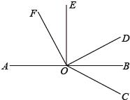

# Mathematics (Grade 4)

**ID**: 3e85f7c6
**难度**: hard
**题型**: multiple_choice

## 题目
如图，O是直线AB上一点，∠AOE=∠FOD=90°，OB平分∠DOC，图中互补的角有（  ）对．
A．10
B．8
C．9
D．7

## 解答

**答案**: D

1. Step1:根据点A、O、B在同一条直线上，依据互补定义得出∠AOF和∠FOB互补，∠AOE和∠EOB互补，∠AOD和∠DOB互补，共3对
2. Step2:由OB平分∠DOC，可得∠DOB=∠BOC，因为∠AOD和∠DOB互补且∠DOB=∠BOC，所以∠AOD和∠BOC互补
3. Step3:由∠AOE=∠FOD=90°，可得∠AOE + ∠FOD = 180°，即∠AOE和∠FOD互补
4. Step4:因为∠AOE=90°，所以∠EOB = 180° - ∠AOE = 90°，又∠FOD=90°，故∠EOB和∠FOD互补
5. Step5:由∠AOE=∠FOD=90°，可得∠AOE - ∠EOF = ∠FOD - ∠EOF，即∠AOF = ∠EOD，又因为OB平分∠DOC，所以∠DOB = ∠BOC，进而可得∠BOF = ∠COE，因为∠AOF和∠FOB互补且∠BOF = ∠COE，所以∠AOF和∠COE互补
6. Step6:统计上述互补的角，共7对，得出答案为D

## 知识点

**知识点**:
  - 角的度量．

---
