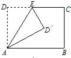

# Mathematics (Grade 4)

**ID**: 3edd776a
**难度**: hard
**题型**: multiple_choice

## 题目
如图，将矩形ABCD沿AE折叠，若∠BAD′=30°，则∠AED′等于（  ）
$\begin{description}
\item A．30°\item B．45°\item C．60°\item D．75°
\end{description}$

## 解答

**答案**: C

1. Step1:由矩形性质可知，矩形ABCD中∠BAD = 90°
2. Step2:因为矩形ABCD沿AE折叠，所以∠EAD′ = ∠EAD，又因为∠BAD = ∠BAD′ + ∠EAD′ + ∠EAD，且∠BAD′ = 30°，所以∠EAD′=(90° - 30°)÷2 = 30°
3. Step3:由折叠性质可得∠D′ = ∠D = 90°
4. Step4:在△AED′中，根据三角形内角和定理，三角形内角和为180°，所以∠AED′ = 180° - ∠D′ - ∠EAD′ = 180° - 90° - 30° = 60°
5. Step5:得出答案为C

## 知识点

**知识点**:
  - 简单图形的折叠问题．

---
