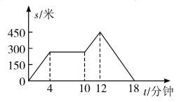

# Mathematics (Grade 4)

**ID**: 7d48ef62
**难度**: hard
**题型**: multiple_choice

## 题目
星期天晚饭后，小军从家里出去散步，下图描述了他散步过程中离家的距离s（米）与散步所用的时间t（分钟）之间的关系。根据下图，下面描述符合小军散步情景的是（）。

A.从家出发，到了一个公共阅报栏，看了一会儿报，就回家了
B.从家出发，到了一个公共阅报栏，看了一会儿报后，继续向前走了一段，然后就回家了
C.从家出发，一直散步（没有停留），然后就回家了
D.从家出发，散了一会儿步，就找同学去了，18分钟后才开始返回

## 解答

**答案**: B

1. Step1:观察函数图象，明确横轴表示散步所用时间t（分钟），纵轴表示离家的距离s（米）
2. Step2:分析图象可知存在四种状态，0 - 4分钟是往前走了一段路程，4 - 10分钟是停留了一段时间，10 - 12分钟是继续往前走，12 - 18分钟是返回
3. Step3:依次分析选项A，其情景对应的图象应为梯形，与所给图象不符，所以A错误
4. Step4:分析选项B，其情景符合图象的特点，所以B正确
5. Step5:分析选项C，其情景对应的图形应为上升和下降的两条折线，与所给图象不符，所以C错误
6. Step6:分析选项D，其情景对应的图象应为梯形，与所给图象不符，所以D错误
7. Step7:综上，答案是B

## 知识点

**知识点**:
  - 看图找关系

---
