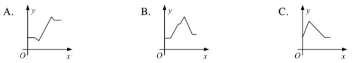

# Mathematics (Grade 4)

**ID**: dea4f415
**难度**: hard
**题型**: multiple_choice

## 题目
乌鸦口渴了，到处找水喝，它看到了一个装有水的瓶子，但瓶口又小，乌鸦喝不着水，沉思一会后，聪明的乌鸦衔来一个个小石子放入瓶中，水位上升后，乌鸦喝到了水。在这则故事中，从乌鸦看到瓶的那刻起开始计时并设时间为x，瓶中水位的高度为y，下列图象中最符合故事情景的是（）

## 解答

**答案**: B

1. Step1:根据题意，乌鸦沉思时时间变化但水位高度y不变，C选项中水位一直变化，所以排除C选项
2. Step2:乌鸦衔来小石子放入瓶中，水位会上升，A选项中水位先下降再上升不符合，所以排除A选项
3. Step3:乌鸦喝水后的水位应不低于一开始的水位，B选项符合这一情况，所以答案是B选项

## 知识点

**知识点**:
  - 单式条形统计图

---
