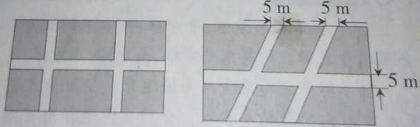

# Mathematics (Grade 4)

**ID**: b6531793
**难度**: hard
**题型**: short_answer

## 题目
一块长105m、宽60m的长方形土地．
 （1）上面修了两条道路互相垂直的小路，宽都是5m，如图，将阴影部分种上草坪，则草坪的面积是多少？
 （2）小明在解决问题后发现：把小路改为如图所示的平行四边形的形状，草坪的面积不变，你同意他的观点吗？为什么？

 5m 5m 5m

## 解答

**答案**: 5225(m^{2}), 草坪面积不变

1. Step1:计算长方形土地的总面积，根据长方形面积公式 S = a×b（其中 a = 105m，b = 60m），可得总面积为 105×60 = 6300m²
2. Step2:计算两条垂直小路的面积，第一条小路面积为 105×5 = 525m²，第二条小路面积为 60×5 = 300m²，两条小路重叠部分面积为 5×5 = 25m²，所以两条小路总面积为 105×5 + 60×5 - 5×5×2 = 525 + 300 - 50 = 775m²
3. Step3:计算阴影部分（草坪）面积，用长方形土地总面积减去两条小路总面积，即 6300 - 775 = 5225m²
4. Step4:分析小路改为平行四边形形状时，平行四边形小路面积计算，一条平行四边形小路面积为 105×5 = 525m²，另外两条平行四边形小路可看作长方形计算，其面积为 60×5×2 - 5×5×2 = 600 - 50 = 550m²，所以改过后小路总面积为 105×5 + (60×5×2 - 5×5×2) = 525 + 550 = 1075m²，和原来两条垂直小路总面积相等
5. Step5:因为土地总面积不变，小路总面积不变，所以草坪面积不变

## 知识点

**知识点**:
  - 

---
