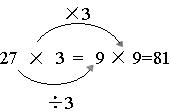

# Mathematics (Grade 4)

**ID**: 005ece9c
**难度**: medium_easy
**题型**: fill_in_the_blank

## 题目
计算 例：27×3=？ 

18×3=________
24×3=________
15×3=________

## 解答

**答案**: 54, 72, 45

1. Step1:计算18×3，根据乘法运算，18×3 = 54
2. Step2:计算24×3，根据乘法运算，24×3 = 72
3. Step3:计算15×3，根据乘法运算，15×3 = 45

## 知识点

**知识点**:
  - 小学数学;数与代数;数的运算;整数的四则运算;整数乘法

---
