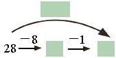

# Mathematics (Grade 4)

**ID**: 0ae03f43
**难度**: medium_easy
**题型**: fill_in_the_blank

## 题目
从上到下，从左到右填空．

## 解答

**答案**: -9, 20, 19

1. Step1:计算28 - 8，可得20
2. Step2:将20作为下一个计算的数
3. Step3:计算20 - 1，可得19
4. Step4:因为28 - 37 = -9，所以第一个空为-9
5. Step5:按照从上到下，从左到右的顺序，第一个空填-9，第二个空填20，第三个空填19

## 知识点

**知识点**:
  - 小学数学;数与代数;数的运算;整数的四则运算;整数的加法、减法

---
