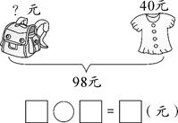

# Mathematics (Grade 4)

**ID**: 0ebd7832
**难度**: medium_easy
**题型**: fill_in_the_blank

## 题目

## 解答

**答案**: 58

1. Step1:已知上衣价格为40元，上衣和书包总价为98元，求书包价格，需用总价减去上衣价格
2. Step2:计算98 - 40 = 58（元），得出书包价格为58元

## 知识点

**知识点**:
  - 小学数学;数与代数;数的运算;整数的四则运算;整数的加法、减法

---
