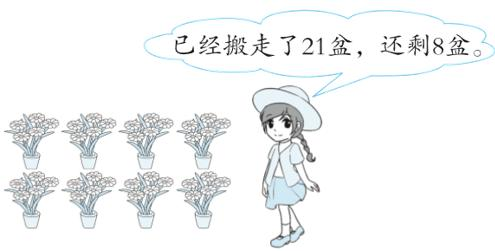

# Mathematics (Grade 4)

**ID**: 124e0cee
**难度**: medium_easy
**题型**: fill_in_the_blank

## 题目
原来一共有多少盆花？

## 解答

**答案**: 29盆

1. Step1:已知已经搬走了21盆，还剩8盆。
2. Step2:求原来一共多少盆花，就是将搬走的盆数和剩下的盆数相加。
3. Step3:21 + 8 = 29盆。

## 知识点

**知识点**:
  - 小学数学;数与代数;数的运算;整数的四则运算

---
