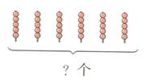

# Mathematics (Grade 4)

**ID**: 2433ad15
**难度**: medium_easy
**题型**: fill_in_the_blank

## 题目
看图列式计算。

口○口＝口（  ）

## 解答

**答案**: 5×6, 6×5, 30个

1. Step1:观察图片可知，图中有6串珠子，每串有5个珠子。
2. Step2:求珠子的总数，根据乘法的意义，可表示为5×6，即6个5相加。
3. Step3:同样根据乘法交换律，也可表示为6×5，即5个6相加。
4. Step4:计算5×6或6×5的结果为30，单位是个，所以答案是30个。

## 知识点

**知识点**:
  - 小学数学;数与代数;数的运算;整数的四则运算;表内乘法

---
