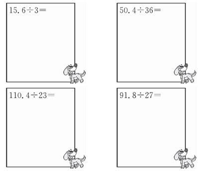

# Mathematics (Grade 4)

**ID**: 2d4419eb
**难度**: medium_easy
**题型**: fill_in_the_blank

## 题目
用竖式计算。

## 解答

**答案**: 5.2, 1.4, 4.8, 3.4

1. Step1:计算15.6÷3，先算15÷3=5，余0，再算0.6÷3=0.2，结果为5 + 0.2 = 5.2
2. Step2:计算50.4÷36，先算50÷36商1余14，再算14.4÷36=0.4，结果为1 + 0.4 = 1.4
3. Step3:计算110.4÷23，先算110÷23商4余18，再算18.4÷23=0.8，结果为4 + 0.8 = 4.8
4. Step4:计算91.8÷27，先算91÷27商3余10，再算10.8÷27=0.4，结果为3 + 0.4 = 3.4

## 知识点

**知识点**:
  - 小学数学;数与代数;数的运算;小数的四则运算;小数的除法

---
