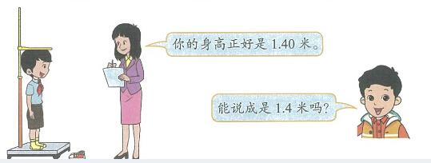

# Mathematics (Grade 4)

**ID**: 331fde31
**难度**: medium_easy
**题型**: fill_in_the_blank

## 题目

 你的身高正好是1.40米   能说成是1.4米吗？

## 解答

**答案**: 1.4米

1. Step1:明确问题是判断1.40米能否说成1.4米
2. Step2:依据小数的性质，1.40末尾的0可以去掉
3. Step3:得出1.40米=1.4米，所以能说成1.4米

## 知识点

**知识点**:
  - 小数;练习二

---
