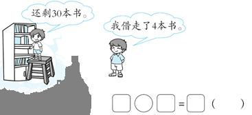

# Mathematics (Grade 4)

**ID**: 3f1fe945
**难度**: medium_easy
**题型**: fill_in_the_blank

## 题目
原来有多少本书？

## 解答

**答案**: 34

1. Step1:已知还剩30本书，借走了4本书，求原来书的数量需要将剩下的和借走的数量相加
2. Step2:进行计算30 + 4 = 34本

## 知识点

**知识点**:
  - 小学数学;数与代数;数的运算;整数的四则运算

---
