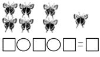

# Mathematics (Grade 4)

**ID**: 45df8cd8
**难度**: medium_easy
**题型**: fill_in_the_blank

## 题目
看图写算式

## 解答

**答案**: 4+2+1=7

1. Step1:观察图片，左边有4只蝴蝶，中间有2只蝴蝶，右边有1只蝴蝶
2. Step2:要求写出算式，根据蝴蝶的数量分布，可列出连加算式
3. Step3:将左边、中间、右边蝴蝶的数量相加，即4 + 2 + 1
4. Step4:得出结果为7，所以算式为4 + 2 + 1 = 7

## 知识点

**知识点**:
  - 小学数学;数与代数;数的运算;整数的四则运算;整数的加法、减法

---
