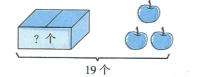

# Mathematics (Grade 4)

**ID**: 47fb1f44
**难度**: medium_easy
**题型**: fill_in_the_blank

## 题目
看图列式计算．

_______ ________ ________=________（个）

## 解答

**答案**: 19, -, 3, 16

1. Step1:观察图片可知，苹果总数是19个，右边有3个苹果
2. Step2:要求的是左边盒子里苹果的数量
3. Step3:根据减法的意义，用总数减去右边的数量就是左边盒子里苹果的数量，所以列式为19 - 3
4. Step4:计算19 - 3的结果为16

## 知识点

**知识点**:
  - 小学数学;数与代数;数的运算;整数的四则运算;整数的加法、减法

---
