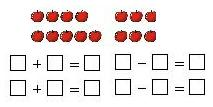

# Mathematics (Grade 4)

**ID**: 499e14c0
**难度**: medium_easy
**题型**: fill_in_the_blank

## 题目
列式计算

## 解答

**答案**: 9+6=15, 15-6=9, 6+9=15, 15-9=6

1. Step1:观察图片，左边有9个草莓，右边有6个草莓
2. Step2:计算草莓总数，可列出加法算式9 + 6 = 15
3. Step3:根据加法交换律，交换加数位置，列出加法算式6 + 9 = 15
4. Step4:已知总数为15，其中一部分是6，求另一部分，列出减法算式15 - 6 = 9
5. Step5:已知总数为15，其中一部分是9，求另一部分，列出减法算式15 - 9 = 6

## 知识点

**知识点**:
  - 小学数学;数与代数;数的运算;整数的四则运算;整数的加法、减法

---
