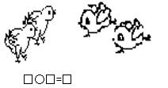

# Mathematics (Grade 4)

**ID**: 4b480ef5
**难度**: medium_easy
**题型**: fill_in_the_blank

## 题目
看图列算式

## 解答

**答案**: 2+2=4

1. Step1:观察图片，左边有2只鸡，右边有2只鸡
2. Step2:求鸡的总数，用加法计算，即2 + 2
3. Step3:得出结果为4，所以算式是2 + 2 = 4

## 知识点

**知识点**:
  - 小学数学;数与代数;数的运算;整数的四则运算;整数的加法、减法;应用题;常见的数学问题;图文问题

---
