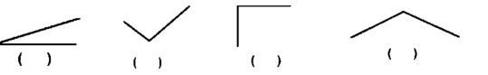

# Mathematics (Grade 4)

**ID**: 53d39837
**难度**: medium_easy
**题型**: fill_in_the_blank

## 题目
以下各角分别是什么角，请标上各个角的名称。

## 解答

**答案**: 锐角, 钝角, 直角, 钝角

1. Step1:观察第一个角，其角度小于90度，根据角的分类，小于90度的角是锐角，所以第一个角是锐角
2. Step2:观察第二个角，其角度大于90度小于180度，根据角的分类，大于90度小于180度的角是钝角，所以第二个角是钝角
3. Step3:观察第三个角，其角度等于90度，根据角的分类，等于90度的角是直角，所以第三个角是直角
4. Step4:观察第四个角，其角度大于90度小于180度，根据角的分类，大于90度小于180度的角是钝角，所以第四个角是钝角

## 知识点

**知识点**:
  - 

---
