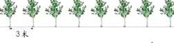

# Mathematics (Grade 4)

**ID**: 5a4559bc
**难度**: medium_easy
**题型**: fill_in_the_blank

## 题目
从第1棵到第8棵树之间一共多少米？

## 解答

**答案**: 21

1. Step1:明确从第1棵树到第8棵树之间的间隔数，8 - 1 = 7个
2. Step2:已知每个间隔为3米，根据总距离 = 间隔数×每个间隔的距离，可得3×7 = 21米

## 知识点

**知识点**:
  - 小学数学;数与代数;数的运算;整数的四则运算

---
