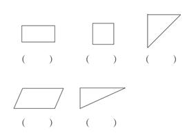

# Mathematics (Grade 4)

**ID**: 5e3ed60d
**难度**: medium_easy
**题型**: fill_in_the_blank

## 题目
把一张正方形的纸折一次，可能折出下面的哪些图形？在可以折出的图形下面的(  )里画“√”。

## 解答

**答案**: √,  , √,  ,  

1. Step1:思考正方形纸沿对角线对折的情况，会得到两个相同的直角三角形，所以第三个图形（直角三角形）可以折出，在其括号里对应标记√
2. Step2:思考正方形纸沿对边中点连线对折的情况，会得到两个相同的长方形，所以第一个图形（长方形）可以折出，在其括号里对应标记√
3. Step3:由于只折一次，无法折出正方形本身，所以第二个图形括号标记空格
4. Step4:只折一次，无法折出平行四边形，所以第四个图形括号标记空格
5. Step5:只折一次，无法折出一般的三角形（非直角三角形），所以第五个图形括号标记空格

## 知识点

**知识点**:
  - 

---
