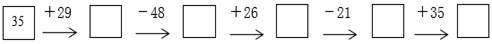

# Mathematics (Grade 4)

**ID**: 62a33fa9
**难度**: medium_easy
**题型**: fill_in_the_blank

## 题目
在方框里写出计算的结果。

## 解答

**答案**: 64, 16, 42, 21, 56

1. Step1:计算35 + 29 = 64
2. Step2:计算64 - 48 = 16
3. Step3:计算16 + 26 = 42
4. Step4:计算42 - 21 = 21
5. Step5:计算21 + 35 = 56

## 知识点

**知识点**:
  - 小学数学;数与代数;数的运算;整数的四则运算;整数的加法、减法

---
