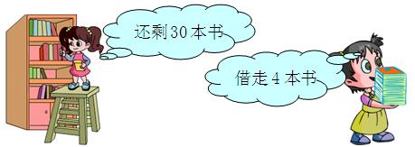

# Mathematics (Grade 4)

**ID**: 650bb6a5
**难度**: medium_easy
**题型**: fill_in_the_blank

## 题目

原来有多少本书？             
□○□＝□（   ）

## 解答

**答案**: 30, 4, 34, 本

1. Step1:明确问题是求原来书的数量，已知还剩30本书，借走4本书
2. Step2:根据数量关系，原来书的数量等于剩下的数量加上借走的数量
3. Step3:得出计算式子为30 + 4
4. Step4:计算30 + 4的结果为34，单位是本

## 知识点

**知识点**:
  - 小学数学;数与代数;数的运算;整数的四则运算

---
