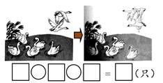

# Mathematics (Grade 4)

**ID**: 67b9ca9a
**难度**: medium_easy
**题型**: fill_in_the_blank

## 题目
看图写算式．

## 解答

**答案**: 7-2+3=8

1. Step1:观察图片，发现原来有7只鸭子
2. Step2:看到有2只鸭子离开
3. Step3:又发现有3只鸭子过来
4. Step4:根据上述情况，先算离开2只后剩余的鸭子数量，即7 - 2
5. Step5:再算又过来3只后的鸭子总数，即7 - 2 + 3
6. Step6:得出算式7 - 2 + 3 = 8

## 知识点

**知识点**:
  - 小学数学;数与代数;数的运算;整数的四则运算;整数四则混合运算

---
